<p align="center">
  <picture>
    <source media="(max-width: 640px)" srcset="media/showcase/hero-mobile.png">
    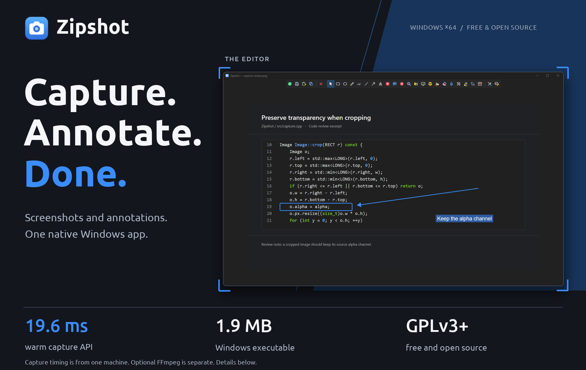
  </picture>
</p>
<p align="center">
  <a href="https://github.com/So2K/Zipshot/releases/latest"></a>
</p>
<p align="center">
  <a href="https://github.com/So2K/Zipshot/releases/download/benchmark-20261118/zipshot-runtime-comparison.mp4">Watch&nbsp;the&nbsp;silent&nbsp;montage</a>
  &nbsp;·&nbsp; <a href="docs/runtime-comparison/README.md">See&nbsp;the&nbsp;test&nbsp;results</a>
  &nbsp;·&nbsp; <a href="#get-started">Get&nbsp;started</a>
</p>

Capture what you need, add context, and copy or save the result. Zipshot brings familiar ShareX-style tools into a native Windows editor.

## From hotkey to saved PNG

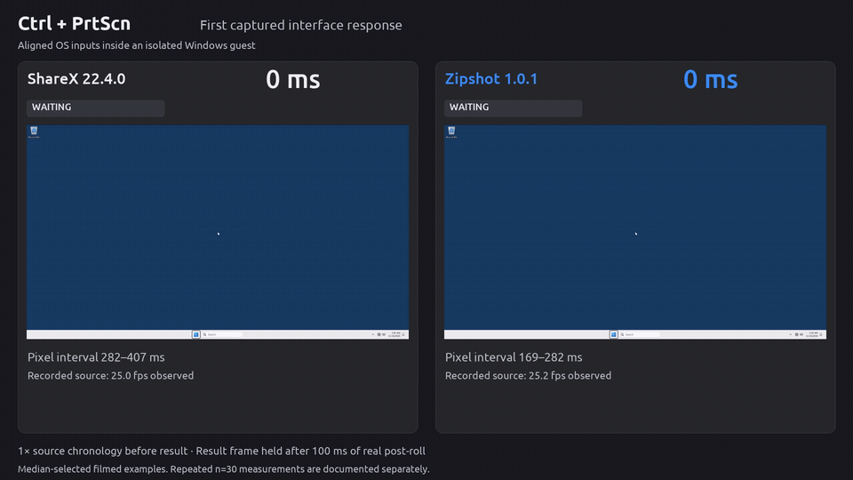

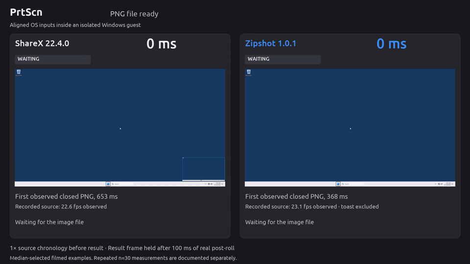

The measured baseline compares Zipshot 1.0.1 with ShareX 22.4.0. ShareX's redesigned interface arrived in [22.0.0 on October 20, 2026](https://getsharex.com/changelog#v22.0.0). Each app and capture scenario has 30 measured calls across three alternating-order blocks, plus nine excluded warmups. No video recorder ran during these statistical blocks.

| Endpoint | Zipshot | ShareX 22.4.0 |
|---|---:|---:|
| Region-overlay first visible change, median bracket | 167.5–216.7 ms | 258.8–316.7 ms |
| Valid clipboard image, median | 300.4 ms | 447.6 ms |
| Closed, readable PNG, median | 341.3 ms | 529.5 ms |

In this Windows Sandbox baseline, Zipshot had about 36% shorter median PNG wait and 33% shorter median clipboard-image wait, with 30 measured calls per app and scenario.

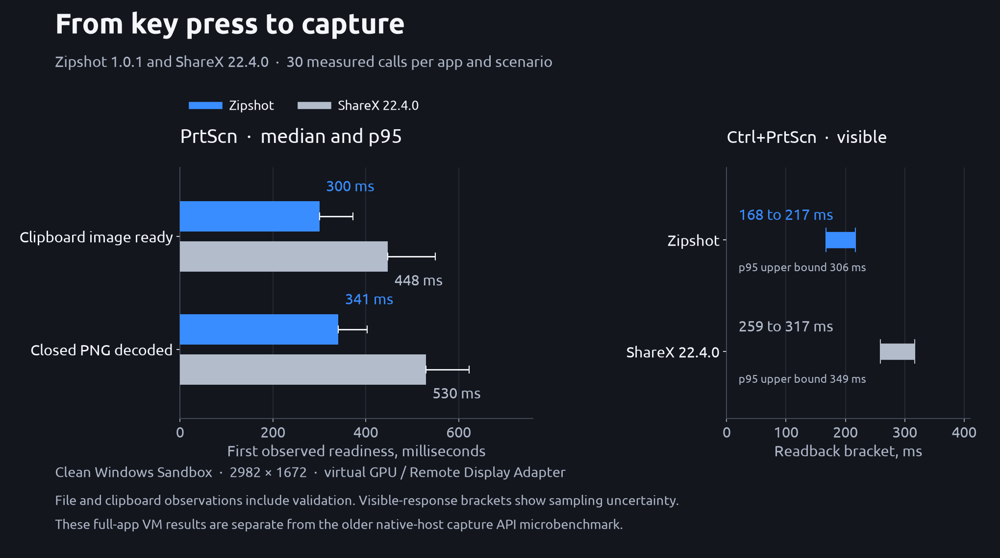

These are Windows Sandbox observations, including polling and validation overhead. The visible result is a sampled time bracket. It does not measure physical keypress-to-monitor latency. [Conditions, p95 values and all trials](docs/runtime-comparison/capture_results.md) · [Charts and raw data](docs/runtime-comparison/README.md).

## Draw right on the capture

Press Ctrl+PrtScn, choose a drawing tool, and make your point before finishing the capture.

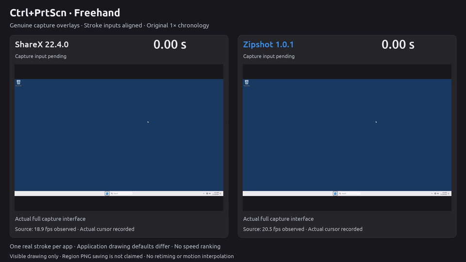

Both complete applications receive the same two-second path in an isolated Windows Sandbox. These are recorded application pixels and synthetic guest mouse/key events, played at 1×. The apps use their default annotation styles. [Region footage and exact input logs](docs/runtime-comparison/editor_UI_RESULTS.md#drawing-immediately-after-ctrlprintscreen).

## Real tools in motion

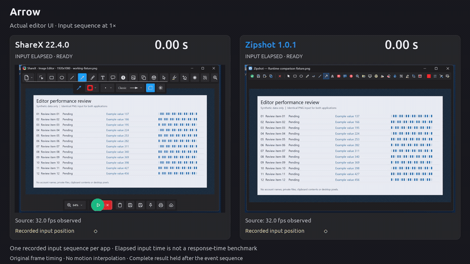

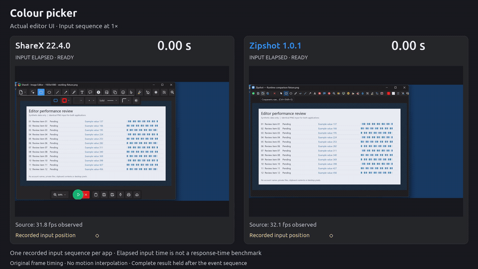

The standalone editor set covers arrows, freehand, text, pixelation, blur, zoom, undo/redo and the color picker. Zipshot uses its unchanged production editor in a guarded native harness; ShareX runs its stock application. Each drawing is one gesture, with about 33 ms observer intervals. The clips show behavior and appearance, without declaring an editor-lag winner.

<details>
<summary>Freehand, text and pixelation</summary>

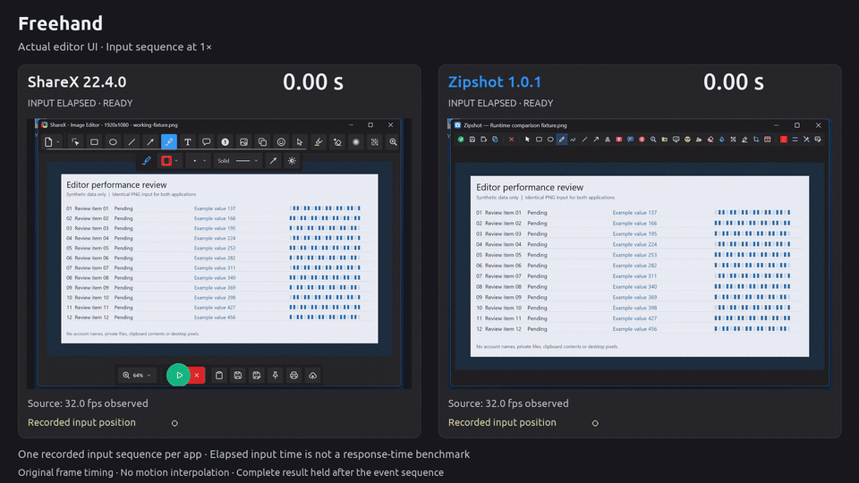

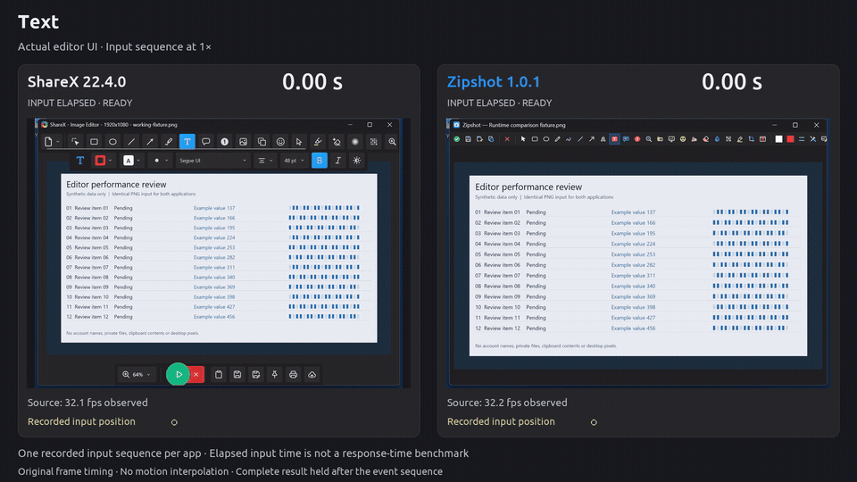

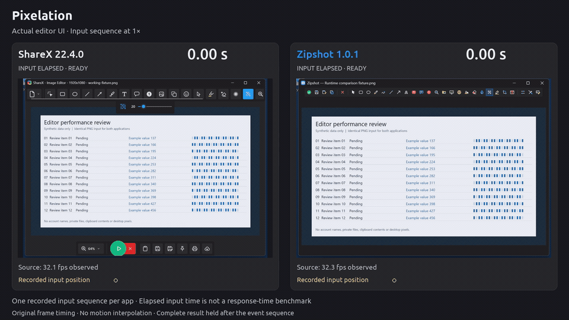

</details>

<details>
<summary>Blur, zoom and undo/redo</summary>


Blur kernels and output strength differ, so equal settings do not mean equal processing quality.


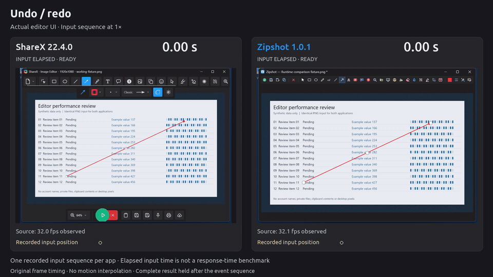

Both undo recordings contain 30 verified visible state changes. The same wheel inputs produce different zoom behavior. [Editor results, limits and original timestamps](docs/runtime-comparison/editor_UI_RESULTS.md).

</details>

## Recording with the costs visible

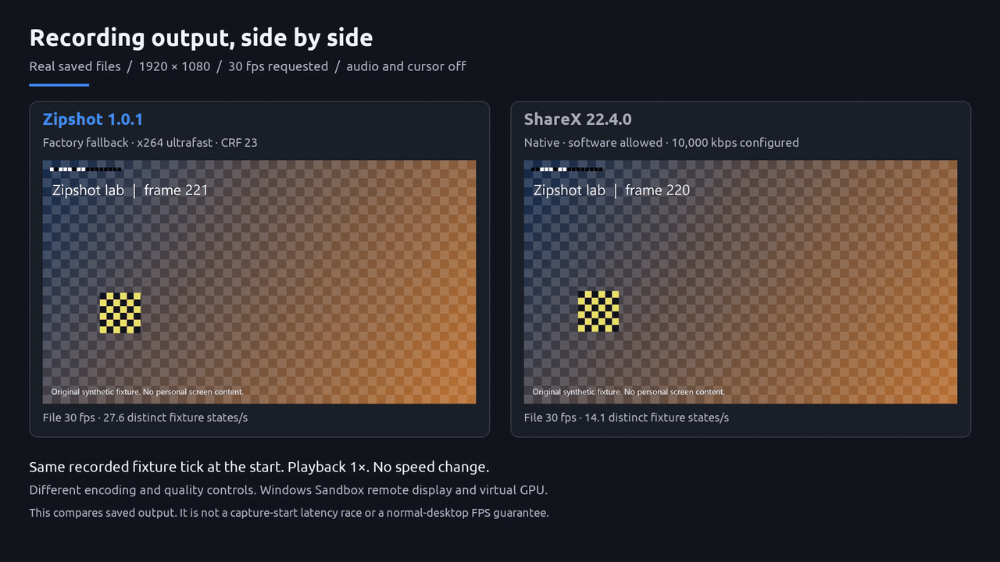

The recording tests retain output checks and CPU/RAM curves, including cases where Zipshot uses more memory. The encoders and quality controls differ. GPU load was not measured in the guest, and ShareX's hardware encoder was unavailable there. [Recording profiles and results](docs/runtime-comparison/recording_results.md).

[Watch the silent runtime montage](https://github.com/So2K/Zipshot/releases/download/benchmark-20261118/zipshot-runtime-comparison.mp4) · [Read the complete report and reproduction guide](docs/runtime-comparison/README.md)

## Make the point

<picture>
  <source media="(max-width: 640px)" srcset="media/showcase/feature-mobile.png">
  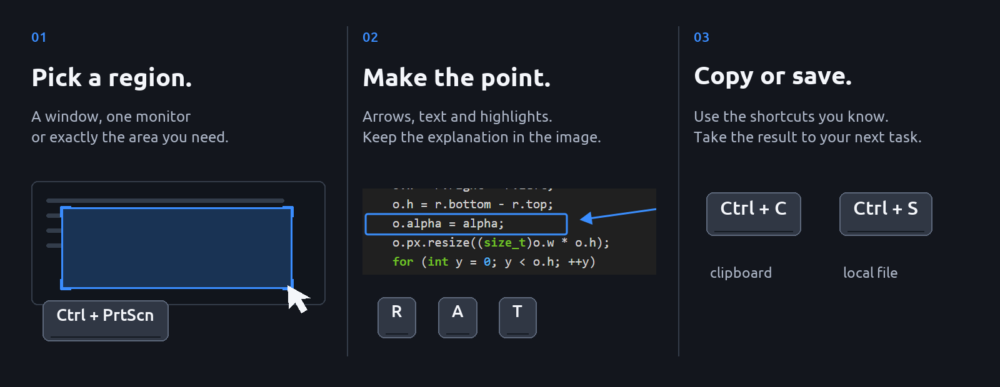
</picture>

Capture a window, one monitor, the desktop, or a region. Return to the previous selection when you need another shot.

Annotate with arrows, shapes, text, step labels and highlights. Blur or pixelate a fragment, add an image, and undo or adjust your edits.

Save locally or copy to the clipboard. Crop, resize, rotate, apply effects, or combine captures before sending them along.

<details>
<summary>Illustrated workflow and the earlier host API test</summary>


These programmed editor renders illustrate the steps. They are separate from the actual runtime GIFs above and are not speed measurements. [Image notes](media/showcase/README.md).

<picture>
  <source media="(max-width: 640px)" srcset="media/showcase/benchmark-mobile.png">
  
</picture>

The hero's 19.6 ms label comes from this earlier warm capture API test on the physical host, against the installed ShareX 18.0.1. Its 60 calls per app gave medians of 19.6 ms and 57.3 ms, about 2.9× in that API-only test. Hotkey dispatch, editing, encoding and saving were excluded. It is not a result for current ShareX 22.4.0 or the full interface. [Methodology](docs/benchmark/README.md) · [Raw API data](docs/benchmark/capture-results.json).

The 1.9 MB label describes the release executable only, excluding optional FFmpeg and sticker packs.

</details>

## Get started

1. [Download Zipshot 1.0.1](https://github.com/So2K/Zipshot/releases/latest), extract the archive to a writable folder, and run `zipshot.exe`.
2. Press Ctrl+PrtScn, drag a region or click a window, and capture. Esc cancels the selection.
3. Click the capture notification to open the editor. Add your annotations, then press Enter to save, copy and close.

Zipshot stays in the system tray. Its menu provides capture commands, settings and Exit. If another capture tool already owns a hotkey, change or disable the conflicting binding in that tool or in Zipshot. The Windows x64 executable is 1.9 MB, or 1,912,320 bytes. It is unsigned, with SHA-256 checksums published in the release.

On first launch, Zipshot attempts to import supported ShareX settings into `zipshot.ini` beside the executable. Otherwise captures go to Pictures\Zipshot, organized by month. By default, images are copied and saved. Opaque PNGs over 2 MB are saved as JPEG. These after-capture tasks and the size threshold are configurable.

Russian and English UI are included, along with custom hotkeys and optional sticker packs. Region recording to MP4 or GIF uses a separate FFmpeg installation.

### Default hotkeys

| Shortcut | Action |
|---|---|
| PrtScn | Capture the entire desktop |
| Ctrl+PrtScn | Select a region |
| Alt+PrtScn | Capture the active window |
| Shift+PrtScn | Start/stop MP4 recording |
| Ctrl+Shift+PrtScn | Start/stop GIF recording |

Imported or configured bindings override these defaults. In the editor, Ctrl+S saves, Ctrl+Shift+S saves as, Ctrl+C copies, and Ctrl+Z / Ctrl+Y undo/redo. Use the mouse wheel to zoom, middle-drag to pan, and Ctrl+0 to fit the image. Text entry and unfinished selections have their own Enter/Esc behavior.

<details>
<summary>Recording and FFmpeg</summary>

Install FFmpeg separately and place `ffmpeg.exe` beside Zipshot, add it to `PATH`, or set `[main] FFmpeg` in `zipshot.ini` to its full path. Recording supports pause/resume controls and a configurable audio input. Encoder and capture-filter availability depend on that FFmpeg build and the machine. NVENC is optional and alternative recording paths are attempted. See [dependency notices](THIRD_PARTY_NOTICES.md).

</details>

<details>
<summary>Settings, custom hotkeys and logs</summary>

`zipshot.ini` stores the save directory, naming patterns, language, after-capture tasks, annotation options and recording settings. Common `[main]` keys are `SaveDir`, `JpegOverKB`, `JpegQuality`, `Sound`, `Language`, `AfterCopy`, `AfterSave`, `AfterToast`, `AfterEditor` and `FFmpeg`.

A `[hotkeys]` section defines the complete binding set. Omitted or empty entries are disabled. Separate alternatives with `;`.

```ini
[hotkeys]
Full=PrintScreen
Region=Ctrl+PrintScreen
Window=Alt+PrintScreen
Video=Shift+PrintScreen
Gif=Ctrl+Shift+PrintScreen
ActiveMonitor=
LastRegion=
```

Restart Zipshot or use its hotkey re-registration command after editing bindings. Logs are written to `%TEMP%\zipshot.log` and `%TEMP%\zipshot_ffmpeg.log`.

</details>

<details>
<summary>Build from source and run the checks</summary>

Zipshot is written in C++ with Win32, Direct2D and Windows Imaging Component, using the static C++ runtime. Install Visual Studio 2022 or Build Tools with Desktop development with C++ and a Windows SDK, then run from the repository root.

```bat
build.bat
tests\run_capture_output_tests.bat
tools\test_image_core.bat
```

`build.bat` locates the C++ toolchain through `vswhere`, or uses an existing developer-shell environment. The x64 release executable is `build\zipshot.exe`. Capture uses DXGI Desktop Duplication with a GDI fallback.

The regression runners use synthetic images and isolated outputs; they do not capture the desktop or change the system clipboard. GitHub Actions runs the release build and both regression suites. The [audit](docs/AUDIT.md) records the fixes, 35 passing regression assertions and remaining limits.

</details>

## Scope and license

Zipshot focuses on local capture and editing. Upload, destination and workflow entries are unavailable placeholders. It does not implement every ShareX feature. Recording/audio devices, every editor tool and the full range of GPU/display configurations have not been exhaustively tested. See the [audit](docs/AUDIT.md).

GNU GPL version 3 or later. See [LICENSE](LICENSE) and [third-party notices](THIRD_PARTY_NOTICES.md) for ShareX resources, Fugue Icons, optional sticker packs and FFmpeg. Zipshot is an independent project and is not endorsed by the ShareX team.

## Help improve Zipshot

Found a problem or have an idea? [Open an issue](https://github.com/So2K/Zipshot/issues/new) with the steps and expected result. Code improvements are welcome through [pull requests](https://github.com/So2K/Zipshot/pulls).
