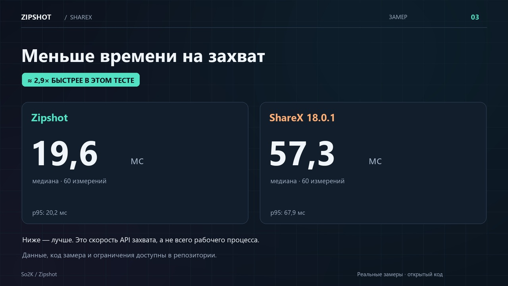

# Zipshot 1.0.1

A native Windows screenshot and annotation tool inspired by ShareX. Capture a region, mark it up, copy it, and save it locally. Written in C++ with Win32, Direct2D and Windows Imaging Component; the executable uses the static C++ runtime.

[Download for Windows x64](https://github.com/So2K/Zipshot/releases/latest) · [Watch the comparison video](media/zipshot-vs-sharex.mp4) · [Benchmark methodology and results](docs/benchmark/README.md) · [Audit and checks](docs/AUDIT.md)

[](https://github.com/So2K/Zipshot/releases/download/v1.0.1/zipshot-vs-sharex.mp4)

The 68-second video includes Russian narration, an original soundtrack, measured results and the real editor operating on synthetic demo data. [Russian subtitles](media/narration.srt) are provided separately. The editor actions are scripted; their playback speed is not a timing benchmark.

## What it does

- Capture the desktop, an active window, a monitor, a selected region, or the previous region. DXGI Desktop Duplication has a GDI fallback.
- Annotate with rectangles, arrows, text, step labels, freehand strokes, blur, pixelation, highlights, images and stickers. Resize, crop, rotate, adjust the canvas, apply image effects, and undo/redo edits.
- Copy, save, show a notification, or open the editor after capture. Browse local captures and combine images.
- Record a region to MP4 or GIF through an optional FFmpeg installation; pause/resume controls and configurable audio input are implemented.
- Use Russian or English UI and import supported ShareX settings.

Zipshot focuses on local capture and editing. Upload, destination and workflow entries are unavailable placeholders; this is not complete ShareX feature parity.

## Install and capture

1. Download the release archive, extract it to a writable folder, and run `zipshot.exe`. The executable is unsigned; verify its published SHA-256 and use a source/build you trust.
2. Zipshot runs in the system tray. Open its menu to capture, edit settings, or exit. If another capture tool owns the same hotkeys, change or disable the conflicting bindings in that tool or in Zipshot.
3. Use a hotkey below, then click the capture notification to open the editor. Drag a region or click a window; Esc cancels the selection.

On first launch, Zipshot attempts to import supported ShareX settings into `zipshot.ini` beside the executable. Otherwise the default save location is the current user's **Pictures\Zipshot** folder, organized by month. By default, captures are copied and saved; opaque PNGs over 2 MB are saved as JPEG. The after-capture tasks and size threshold are configurable.

### Default hotkeys

| Shortcut | Action |
|---|---|
| PrtScn | Capture the entire desktop |
| Ctrl+PrtScn | Select a region |
| Alt+PrtScn | Capture the active window |
| Shift+PrtScn | Start/stop MP4 recording |
| Ctrl+Shift+PrtScn | Start/stop GIF recording |

Imported or configured bindings override these defaults. In the editor, **Ctrl+S** saves, **Ctrl+Shift+S** saves as, **Ctrl+C** copies, **Ctrl+Z / Ctrl+Y** undo/redo, and **Enter** applies, saves, copies and closes. Text entry and unfinished selections have their own Enter/Esc behavior. Use the mouse wheel to zoom, middle-drag to pan, and Ctrl+0 to fit the image.

## Settings and recording

`zipshot.ini` stores the save directory, naming patterns, language, after-capture tasks, annotation options and recording settings. Common `[main]` keys are `SaveDir`, `JpegOverKB`, `JpegQuality`, `Sound`, `Language`, `AfterCopy`, `AfterSave`, `AfterToast`, `AfterEditor` and `FFmpeg`.

For recording, install FFmpeg separately and place `ffmpeg.exe` beside Zipshot, add it to `PATH`, or set `FFmpeg` to its full path. Encoder and capture-filter availability depend on that FFmpeg build and the machine; NVENC is optional and alternative recording paths are attempted. See [dependency notices](THIRD_PARTY_NOTICES.md).

A `[hotkeys]` section defines the complete binding set: omitted or empty entries are disabled. Separate alternatives with `;`. For example:

```ini
[hotkeys]
Full=PrintScreen
Region=Ctrl+PrintScreen
Window=Alt+PrintScreen
Video=Shift+PrintScreen
Gif=Ctrl+Shift+PrintScreen
ActiveMonitor=
LastRegion=
```

Restart Zipshot or use its hotkey re-registration command after editing bindings. Logs are written to `%TEMP%\zipshot.log` and `%TEMP%\zipshot_ffmpeg.log`.

## Build and check

Install Visual Studio 2022 or Build Tools with **Desktop development with C++** and a Windows SDK. From the repository root:

```bat
build.bat
tests\run_capture_output_tests.bat
tools\test_image_core.bat
```

`build.bat` locates the C++ toolchain through `vswhere`, or uses an existing developer-shell environment. The x64 release executable is `build\zipshot.exe`. The regression runners use synthetic images and isolated outputs; they do not capture the desktop or change the system clipboard. GitHub Actions runs the release build and both regression suites.

## Performance and scope

On the test machine, Zipshot's warm full-desktop capture API had a **19.6 ms median**, compared with **57.3 ms** for the installed **ShareX 18.0.1**: approximately **2.9× faster** across 60 measured calls per application. The [comparison report](docs/benchmark/README.md) describes the tested operation, versions, machine, sample counts and limitations; [raw measurements](docs/benchmark/capture-results.json) are included. These API timings exclude hotkey dispatch, editing, encoding and saving. No universal “1000× faster” claim is made.

The [bounded code audit](docs/AUDIT.md) records fixes and 35 automated regression assertions. Recording/audio devices, all GPU/display configurations, every editor tool and arbitrary malformed files have not been exhaustively tested.

## License

GNU GPL version 3 or later. See [LICENSE](LICENSE) and [third-party notices](THIRD_PARTY_NOTICES.md) for ShareX resources, Fugue Icons, optional sticker packs and FFmpeg. Zipshot is an independent project and is not endorsed by the ShareX team.
