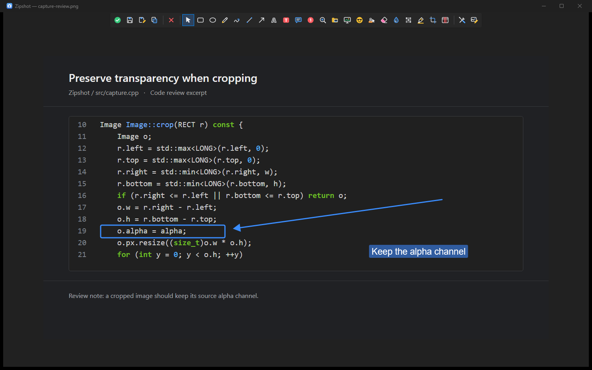
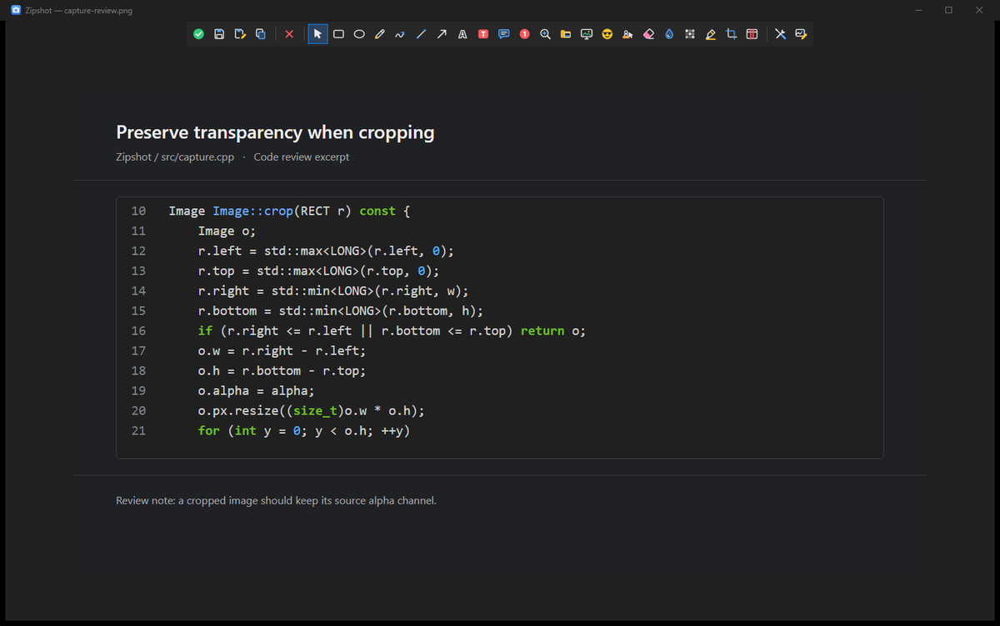
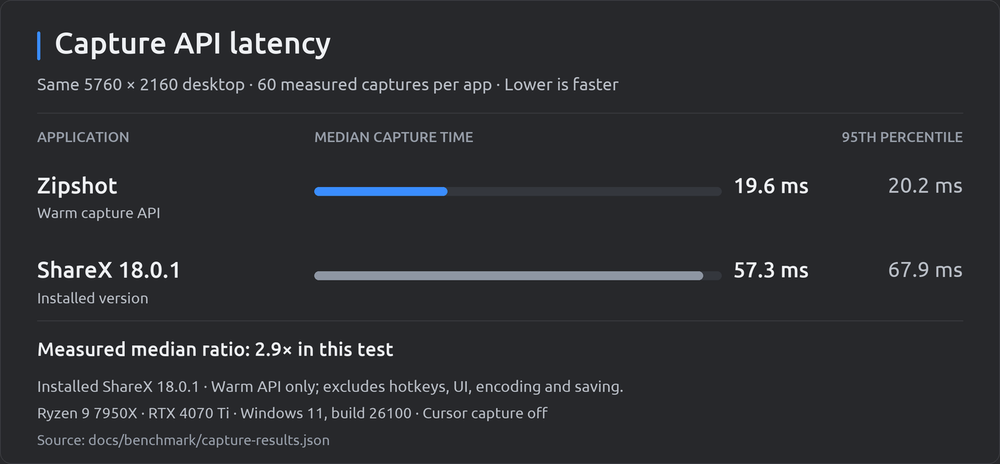

<p align="center">
  
</p>
<h1 align="center">Zipshot</h1>
<p align="center">Screenshots and quick annotations for Windows.</p>
<p align="center">
  <a href="https://github.com/So2K/Zipshot/releases/latest"><strong>Download for Windows x64</strong></a>
  &nbsp;·&nbsp; <a href="#get-started">Get started</a>
  &nbsp;·&nbsp; <a href="docs/benchmark/README.md">Benchmarks</a>
</p>

Capture a window or region, point out what matters, and copy or save the result. Zipshot brings familiar ShareX-style tools into a native Windows editor.



## Capture, mark up, send it along

Add an arrow, highlight a detail, blur a fragment, or leave a short note. Undo and adjust until the image says what you need.



*Scripted renders using Zipshot's editor. Playback illustrates the workflow; it is not a speed measurement. [Image notes](media/page/README.md).*

- **Capture what you need:** the desktop, an active window, one monitor, a region, or the previous selection.
- **Make the point:** arrows, rectangles, text, step labels, freehand strokes, highlights, blur and pixelation. Add images or optional stickers.
- **Finish the image:** crop, resize, rotate, adjust the canvas, apply effects, or combine captures. Save locally, copy to the clipboard, or return to the editor from a notification.
- **Record a region:** MP4 or GIF with an optional FFmpeg installation, with pause/resume controls and configurable audio input.
- **Keep familiar settings:** Russian and English UI, configurable hotkeys, and import of supported ShareX settings.

## Capture performance



On the test machine, Zipshot's warm full-desktop capture API took **19.6 ms median**, compared with **57.3 ms** for the installed **ShareX 18.0.1**: about **2.9× faster**, with 60 measured calls per application. These timings exclude hotkey dispatch, editing, encoding and saving. See the [methodology and limitations](docs/benchmark/README.md) and [raw measurements](docs/benchmark/capture-results.json).

[Watch the 68-second Russian walkthrough and comparison](https://github.com/So2K/Zipshot/releases/download/v1.0.1/zipshot-vs-sharex.mp4) · [Russian subtitles](media/narration.srt)

The video includes narration, an original soundtrack and the editor working on synthetic demo data. Its scripted editing sequence is illustrative; only the separately described API measurements are timed results.

## Get started

1. [Download Zipshot 1.0.1](https://github.com/So2K/Zipshot/releases/latest), extract the archive to a writable folder, and run `zipshot.exe`.
2. Press **Ctrl+PrtScn**, drag a region or click a window, and capture. **Esc** cancels the selection.
3. Click the capture notification to open the editor. Add your annotations, then press **Enter** to save, copy and close.

Zipshot stays in the system tray; its menu provides capture commands, settings and Exit. If another capture tool already owns a hotkey, change or disable the conflicting binding in that tool or in Zipshot. The release executable is unsigned; SHA-256 checksums are published with the release.

On first launch, Zipshot attempts to import supported ShareX settings into `zipshot.ini` beside the executable. Otherwise captures go to **Pictures\Zipshot**, organized by month. By default, images are copied and saved; opaque PNGs over 2 MB are saved as JPEG. These after-capture tasks and the size threshold are configurable.

### Default hotkeys

| Shortcut | Action |
|---|---|
| PrtScn | Capture the entire desktop |
| Ctrl+PrtScn | Select a region |
| Alt+PrtScn | Capture the active window |
| Shift+PrtScn | Start/stop MP4 recording |
| Ctrl+Shift+PrtScn | Start/stop GIF recording |

Imported or configured bindings override these defaults. In the editor, **Ctrl+S** saves, **Ctrl+Shift+S** saves as, **Ctrl+C** copies, and **Ctrl+Z / Ctrl+Y** undo/redo. Use the mouse wheel to zoom, middle-drag to pan, and **Ctrl+0** to fit the image. Text entry and unfinished selections have their own Enter/Esc behavior.

<details>
<summary><strong>Recording and FFmpeg</strong></summary>

Install FFmpeg separately and place `ffmpeg.exe` beside Zipshot, add it to `PATH`, or set `[main] FFmpeg` in `zipshot.ini` to its full path. Encoder and capture-filter availability depend on that FFmpeg build and the machine; NVENC is optional and alternative recording paths are attempted. See [dependency notices](THIRD_PARTY_NOTICES.md).

</details>

<details>
<summary><strong>Settings, custom hotkeys and logs</strong></summary>

`zipshot.ini` stores the save directory, naming patterns, language, after-capture tasks, annotation options and recording settings. Common `[main]` keys are `SaveDir`, `JpegOverKB`, `JpegQuality`, `Sound`, `Language`, `AfterCopy`, `AfterSave`, `AfterToast`, `AfterEditor` and `FFmpeg`.

A `[hotkeys]` section defines the complete binding set: omitted or empty entries are disabled. Separate alternatives with `;`. For example:

```ini
[hotkeys]
Full=PrintScreen
Region=Ctrl+PrintScreen
Window=Alt+PrintScreen
Video=Shift+PrintScreen
Gif=Ctrl+Shift+PrintScreen
ActiveMonitor=
LastRegion=
```

Restart Zipshot or use its hotkey re-registration command after editing bindings. Logs are written to `%TEMP%\zipshot.log` and `%TEMP%\zipshot_ffmpeg.log`.

</details>

<details>
<summary><strong>Build from source and run the checks</strong></summary>

Zipshot is written in C++ with Win32, Direct2D and Windows Imaging Component, using the static C++ runtime. Install Visual Studio 2022 or Build Tools with **Desktop development with C++** and a Windows SDK, then run from the repository root:

```bat
build.bat
tests\run_capture_output_tests.bat
tools\test_image_core.bat
```

`build.bat` locates the C++ toolchain through `vswhere`, or uses an existing developer-shell environment. The x64 release executable is `build\zipshot.exe`. Capture uses DXGI Desktop Duplication with a GDI fallback.

The regression runners use synthetic images and isolated outputs; they do not capture the desktop or change the system clipboard. GitHub Actions runs the release build and both regression suites. The [audit](docs/AUDIT.md) records the fixes, 35 passing regression assertions and remaining limits.

</details>

## Scope and license

Zipshot focuses on local capture and editing. Upload, destination and workflow entries are unavailable placeholders; it does not implement every ShareX feature. Recording/audio devices, every editor tool and the full range of GPU/display configurations have not been exhaustively tested; see the [audit](docs/AUDIT.md).

GNU GPL version 3 or later. See [LICENSE](LICENSE) and [third-party notices](THIRD_PARTY_NOTICES.md) for ShareX resources, Fugue Icons, optional sticker packs and FFmpeg. Zipshot is an independent project and is not endorsed by the ShareX team.
