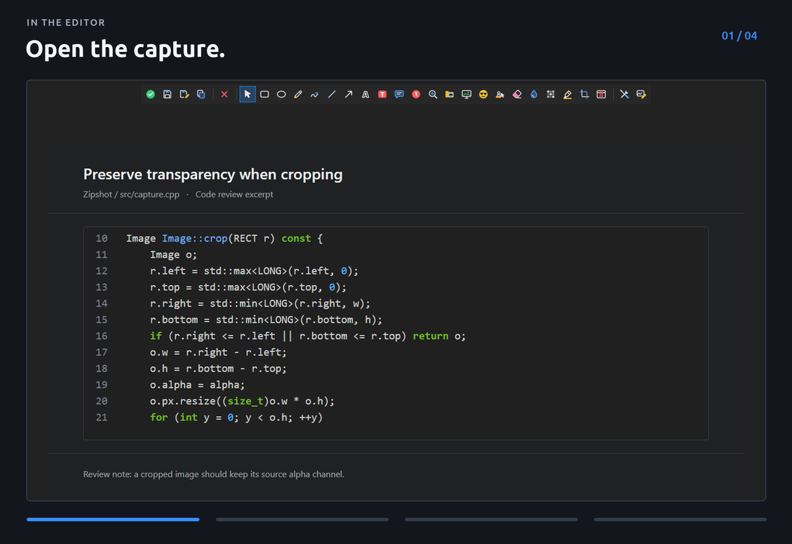

<p align="center">
  <picture>
    <source media="(max-width: 640px)" srcset="media/showcase/hero-mobile.png">
    
  </picture>
</p>
<p align="center">
  <a href="https://github.com/So2K/Zipshot/releases/latest"></a>
</p>
<p align="center">
  <a href="https://github.com/So2K/Zipshot/releases/download/v1.0.1/zipshot-vs-sharex.mp4">Watch&nbsp;the&nbsp;demo</a>
  &nbsp;·&nbsp; <a href="docs/benchmark/README.md">Read&nbsp;the&nbsp;benchmark</a>
  &nbsp;·&nbsp; <a href="#get-started">Get&nbsp;started</a>
</p>

Capture what you need, add context, and copy or save the result. Zipshot brings familiar ShareX-style tools into a native Windows editor.

The 19.6 ms figure is the median from [our warm capture API test](docs/benchmark/README.md). It excludes the interface, editing and saving. The 1.9 MB executable does not include optional FFmpeg or sticker packs.

## Make the point

<picture>
  <source media="(max-width: 640px)" srcset="media/showcase/feature-mobile.png">
  
</picture>

Capture a window, one monitor, the desktop, or a region. Return to the previous selection when you need another shot.

Annotate with arrows, shapes, text, step labels and highlights. Blur or pixelate a fragment, add an image, and undo or adjust your edits.

Save locally or copy to the clipboard. Crop, resize, rotate, apply effects, or combine captures before sending them along.

## A few edits, one clear image



Scripted renders using Zipshot's editor show the steps. Playback illustrates the workflow and is not a speed measurement. [Image notes](media/showcase/README.md).

## 2.9× faster capture in this test

<picture>
  <source media="(max-width: 640px)" srcset="media/showcase/benchmark-mobile.png">
  
</picture>

On the test machine, Zipshot's warm full-desktop capture API took 19.6 ms median, compared with 57.3 ms for the installed ShareX 18.0.1. That is about 2.9× faster across 60 measured calls per application. These timings exclude hotkey dispatch, editing, encoding and saving. See the [methodology and limits](docs/benchmark/README.md) and [raw measurements](docs/benchmark/capture-results.json).

[Watch the 68-second Russian walkthrough and comparison](https://github.com/So2K/Zipshot/releases/download/v1.0.1/zipshot-vs-sharex.mp4) · [Russian subtitles](media/narration.srt)

The video includes narration, an original soundtrack and the editor working on synthetic demo data. Its editing sequence is scripted. Only the separately described API measurements are timed results.

## Get started

1. [Download Zipshot 1.0.1](https://github.com/So2K/Zipshot/releases/latest), extract the archive to a writable folder, and run `zipshot.exe`.
2. Press Ctrl+PrtScn, drag a region or click a window, and capture. Esc cancels the selection.
3. Click the capture notification to open the editor. Add your annotations, then press Enter to save, copy and close.

Zipshot stays in the system tray. Its menu provides capture commands, settings and Exit. If another capture tool already owns a hotkey, change or disable the conflicting binding in that tool or in Zipshot. The Windows x64 executable is 1.9 MB, or 1,912,320 bytes. It is unsigned, with SHA-256 checksums published in the release.

On first launch, Zipshot attempts to import supported ShareX settings into `zipshot.ini` beside the executable. Otherwise captures go to Pictures\Zipshot, organized by month. By default, images are copied and saved. Opaque PNGs over 2 MB are saved as JPEG. These after-capture tasks and the size threshold are configurable.

Russian and English UI are included, along with custom hotkeys and optional sticker packs. Region recording to MP4 or GIF uses a separate FFmpeg installation.

### Default hotkeys

| Shortcut | Action |
|---|---|
| PrtScn | Capture the entire desktop |
| Ctrl+PrtScn | Select a region |
| Alt+PrtScn | Capture the active window |
| Shift+PrtScn | Start/stop MP4 recording |
| Ctrl+Shift+PrtScn | Start/stop GIF recording |

Imported or configured bindings override these defaults. In the editor, Ctrl+S saves, Ctrl+Shift+S saves as, Ctrl+C copies, and Ctrl+Z / Ctrl+Y undo/redo. Use the mouse wheel to zoom, middle-drag to pan, and Ctrl+0 to fit the image. Text entry and unfinished selections have their own Enter/Esc behavior.

<details>
<summary>Recording and FFmpeg</summary>

Install FFmpeg separately and place `ffmpeg.exe` beside Zipshot, add it to `PATH`, or set `[main] FFmpeg` in `zipshot.ini` to its full path. Recording supports pause/resume controls and a configurable audio input. Encoder and capture-filter availability depend on that FFmpeg build and the machine. NVENC is optional and alternative recording paths are attempted. See [dependency notices](THIRD_PARTY_NOTICES.md).

</details>

<details>
<summary>Settings, custom hotkeys and logs</summary>

`zipshot.ini` stores the save directory, naming patterns, language, after-capture tasks, annotation options and recording settings. Common `[main]` keys are `SaveDir`, `JpegOverKB`, `JpegQuality`, `Sound`, `Language`, `AfterCopy`, `AfterSave`, `AfterToast`, `AfterEditor` and `FFmpeg`.

A `[hotkeys]` section defines the complete binding set. Omitted or empty entries are disabled. Separate alternatives with `;`.

```ini
[hotkeys]
Full=PrintScreen
Region=Ctrl+PrintScreen
Window=Alt+PrintScreen
Video=Shift+PrintScreen
Gif=Ctrl+Shift+PrintScreen
ActiveMonitor=
LastRegion=
```

Restart Zipshot or use its hotkey re-registration command after editing bindings. Logs are written to `%TEMP%\zipshot.log` and `%TEMP%\zipshot_ffmpeg.log`.

</details>

<details>
<summary>Build from source and run the checks</summary>

Zipshot is written in C++ with Win32, Direct2D and Windows Imaging Component, using the static C++ runtime. Install Visual Studio 2022 or Build Tools with Desktop development with C++ and a Windows SDK, then run from the repository root.

```bat
build.bat
tests\run_capture_output_tests.bat
tools\test_image_core.bat
```

`build.bat` locates the C++ toolchain through `vswhere`, or uses an existing developer-shell environment. The x64 release executable is `build\zipshot.exe`. Capture uses DXGI Desktop Duplication with a GDI fallback.

The regression runners use synthetic images and isolated outputs; they do not capture the desktop or change the system clipboard. GitHub Actions runs the release build and both regression suites. The [audit](docs/AUDIT.md) records the fixes, 35 passing regression assertions and remaining limits.

</details>

## Scope and license

Zipshot focuses on local capture and editing. Upload, destination and workflow entries are unavailable placeholders. It does not implement every ShareX feature. Recording/audio devices, every editor tool and the full range of GPU/display configurations have not been exhaustively tested. See the [audit](docs/AUDIT.md).

GNU GPL version 3 or later. See [LICENSE](LICENSE) and [third-party notices](THIRD_PARTY_NOTICES.md) for ShareX resources, Fugue Icons, optional sticker packs and FFmpeg. Zipshot is an independent project and is not endorsed by the ShareX team.

## Help improve Zipshot

Found a problem or have an idea? [Open an issue](https://github.com/So2K/Zipshot/issues/new) with the steps and expected result. Code improvements are welcome through [pull requests](https://github.com/So2K/Zipshot/pulls).
