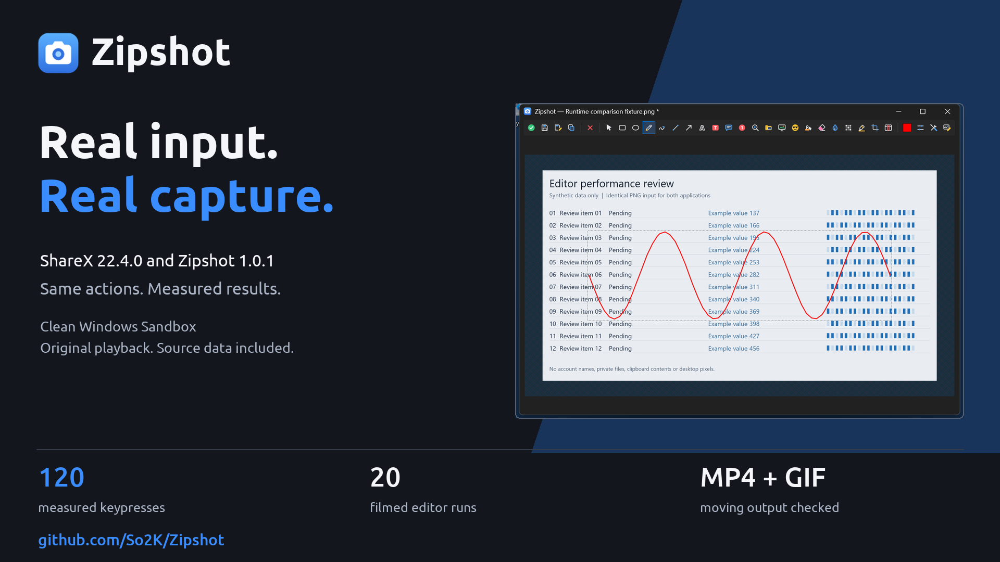
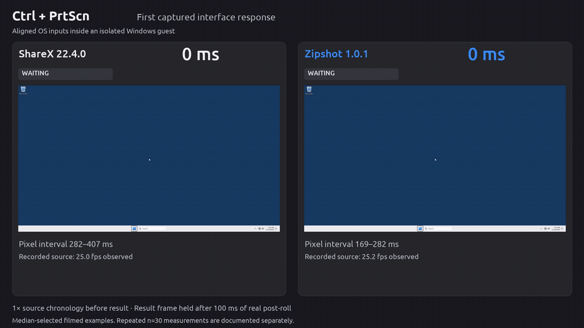
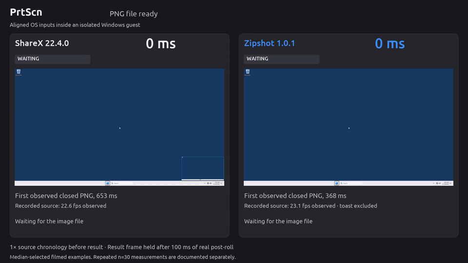
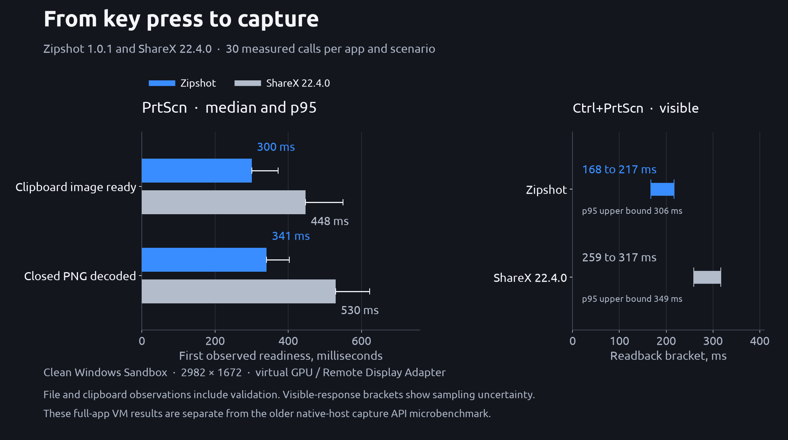
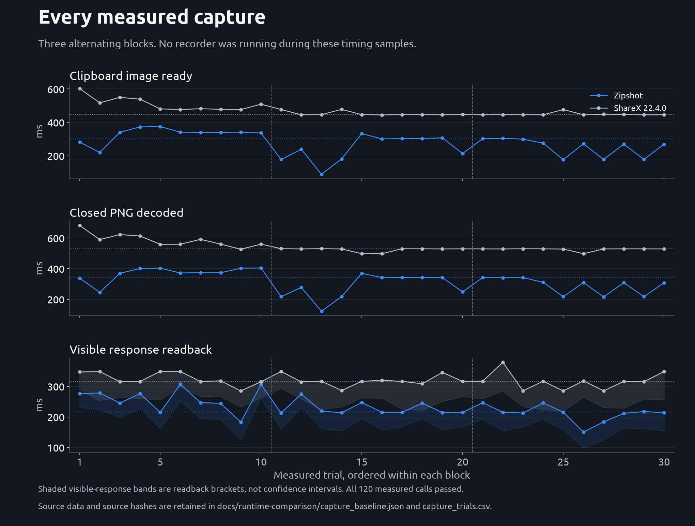
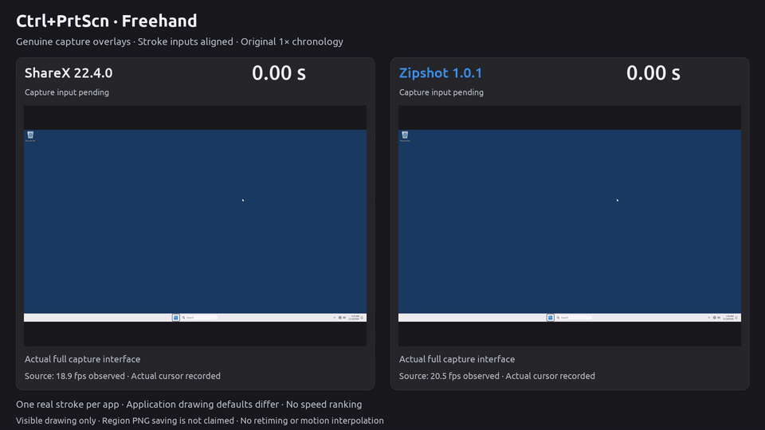
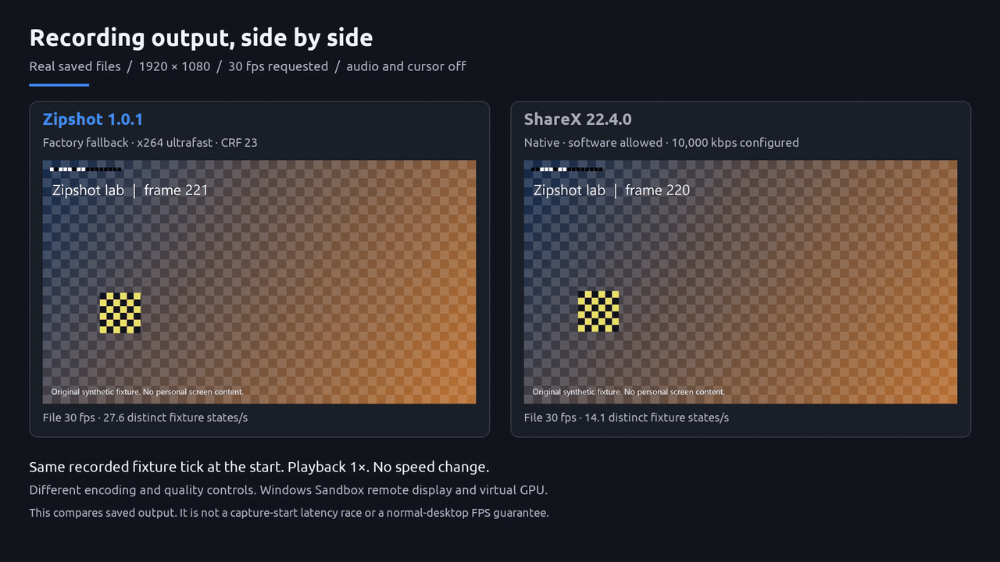
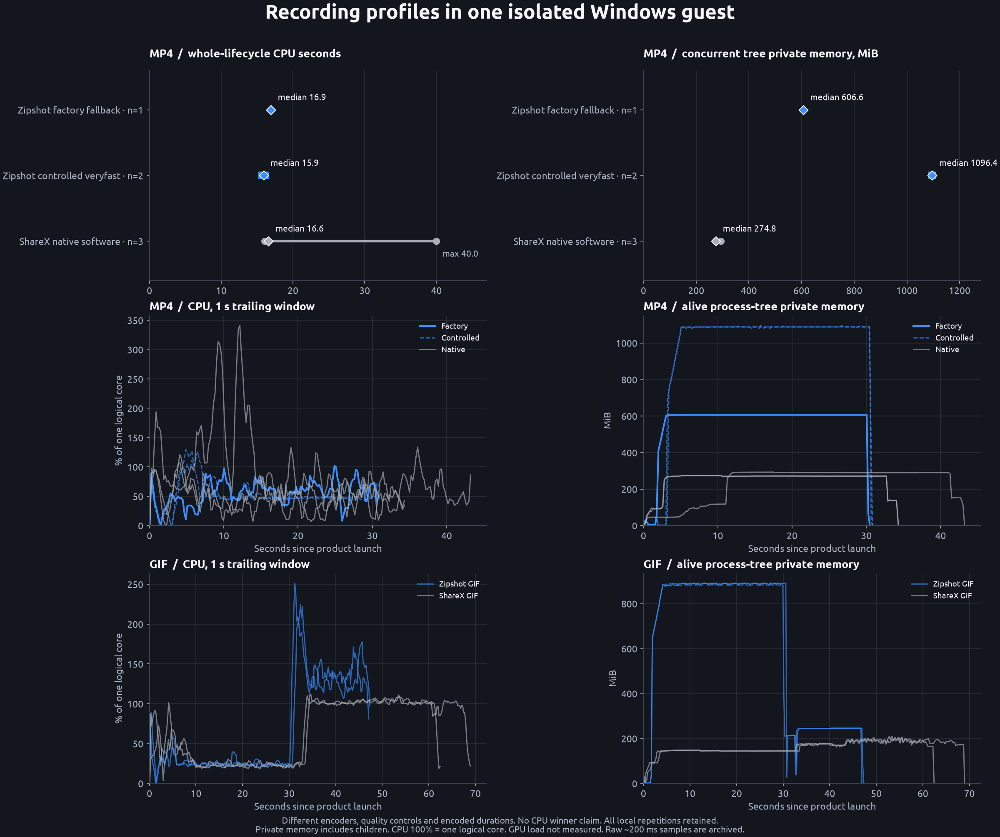

# Zipshot and ShareX in use

This comparison follows actual capture, drawing and recording work in an isolated Windows Sandbox. It compares the unchanged Zipshot 1.0.1 release with official ShareX 22.4.0. ShareX's redesigned interface arrived in [22.0.0 on October 20, 2026](https://getsharex.com/changelog#v22.0.0). Measurements were collected on November 18, 2026. The older installed ShareX 18.0.1 appears only in clearly separated component tests.

[](https://github.com/So2K/Zipshot/releases/download/benchmark-20261118/zipshot-runtime-comparison.mp4)

[Silent montage MP4](https://github.com/So2K/Zipshot/releases/download/benchmark-20261118/zipshot-runtime-comparison.mp4) · [Capture results](capture_results.md) · [Editor results](editor_UI_RESULTS.md) · [Recording results](recording_results.md)

The montage shows the actual runtime clips without voice, music or a subtitle track.

Zipshot reached the capture endpoints sooner in this guest baseline. The editor clips show real actions with different tool behavior and appearance. Recording profiles are not quality-matched, and the results do not establish a general low-load or GPU advantage. Each conclusion below stays within its measured scenario.

## Capture endpoints





The statistical baseline has 30 measured trials per app and scenario, collected as three alternating-order blocks of ten. Each block excludes three warmups per app, or nine per app/scenario. There are 120 accepted measured trials and 36 excluded warmups overall. The separately recorded demonstrations are not pooled into these statistics.

| Endpoint | Zipshot median | Zipshot p95 | ShareX 22.4.0 median | ShareX p95 |
|---|---:|---:|---:|---:|
| First target-confirmed region-overlay change | 167.5–216.7 ms bracket | 306.2 ms upper bound | 258.8–316.7 ms bracket | 349.4 ms upper bound |
| First observed valid clipboard image | 300.4 ms | 372.9 ms | 447.6 ms | 549.8 ms |
| First observed closed, readable PNG | 341.3 ms | 403.3 ms | 529.5 ms | 622.7 ms |

In this Windows Sandbox baseline, Zipshot had about 36% shorter median PNG wait and 33% shorter median clipboard-image wait, with 30 measured calls per app and scenario.



The visible bracket runs from the start of the last unchanged desktop readback to the end of the first changed readback. Median bracket widths were 53.5 ms and 56.5 ms. Clipboard and file values include polling and image validation overhead. All full-capture outputs had the actual 2982×1672 desktop dimensions.

No FFmpeg recorder ran during these baseline blocks. The persistent GDI observer checked a defined 1280×720 ROI and required product-window evidence. A first changed ROI does not establish that every control is ready or that a physical monitor has displayed the frame.

Zipshot excludes its notification from screen capture through `WDA_EXCLUDEFROMCAPTURE`. Its toast was therefore unobservable in the screen-readback endpoint. The demo labels its genuine saved-PNG preview separately. No fake notification, zero-latency value or comparative toast-speed claim is substituted.



[Full capture report](capture_results.md) · [Chart SVG](../../media/runtime/capture-latency.svg) · [Trial-trace SVG](../../media/runtime/capture-traces.svg) · [Grouped JSON and source hashes](capture_baseline.json) · [All trials CSV](capture_trials.csv) · [All observer readbacks CSV](capture_frames.csv)

## Draw directly in region capture



The complete unmodified applications receive a real guest `Ctrl+PrintScreen` through Windows `SendInput`. After an owned foreground full-screen overlay appears, `A` or `F` selects the tool. Each app receives the same 120 screen-coordinate points over two seconds. Both arrows and freehand paths were visibly checked in four original recordings.

These are synthetic OS mouse/key events inside the guest, not physical hardware input. The GDI observer includes the actual guest cursor. The apps use their defaults, including Zipshot's green and ShareX's red, so color, width, shadow and smoothing are not quality-matched.

The full-display source recordings contain about 17.7–22.7 frames per second. They show the actual workflow at 1× and do not establish input latency or UI frame rate. The pause before drawing includes controller setup and a separate screenshot readback. It is not app waiting time. Edited clips may trim setup or hold a labelled final result without changing the speed of the action.

[Region source manifest and exact hotkey/tool/button offsets](editor_region_runs.json) · [Detailed checks and save limits](editor_UI_RESULTS.md#drawing-immediately-after-ctrlprintscreen)

## Editor actions and visible results

The standalone set contains 16 actual recordings, one run per app for eight actions. Zipshot uses its unchanged production editor and real HWND render target in a guarded native harness. ShareX runs its unmodified stock application. These are separate from the complete-app region recordings above.

| Action | What was verified | Interpretation |
|---|---|---|
| [Arrow GIF](../../media/runtime/editor-arrow.gif) | Actual red arrow and saved edited PNG in both apps | Same four-pixel width, shadow off, 120 points over two seconds |
| [Freehand GIF](../../media/runtime/editor-freehand.gif) | Actual three-wave stroke and saved edited PNG in both apps | Same source-image points, different smoothing |
| [Color picker GIF](../../media/runtime/editor-colorpicker.gif) | Real picker popup in both recordings | Untimed feature demonstration |
| [Text GIF](../../media/runtime/editor-text.gif) | “Check this value” entered in both apps | Default fonts, fill and outline differ |
| [Pixelate GIF](../../media/runtime/editor-pixelate.gif) | Actual central pixelation in both apps | Default block settings differ |
| [Blur GIF](../../media/runtime/editor-blur.gif) | Central 4K region blurred and repeated after undo | Settings at 15 use different kernels and strengths |
| [Zoom GIF](../../media/runtime/editor-zoom.gif) | Actual image magnification changes | Same wheel inputs, different resulting zoom behavior |
| [Undo/redo GIF](../../media/runtime/editor-undo.gif) | Exactly 30 decoded red on/off transitions per app | Same alternating shortcuts at 100 ms intervals |

The arrow and pencil use the same generated 1920×1080 PNG. Blur uses the corresponding 3840×2160 fixture. The fitted image scales differ by 0.68%, with both actual transforms retained. Text, blur, pixelation, zoom and the picker are feature demonstrations rather than equivalent-quality speed tests.

The cursor-free standalone observer requested 60 fps but captured about 32 frames per second. One two-second gesture per app/tool and approximately 33 ms observation intervals do not establish an editor-lag winner. The CSV preserves video-sampled estimates and their limits. It does not describe physical display latency or 30 independent gesture trials.

The native zoom sequence returns to its starting view. ShareX reaches 300% mid-recording and ends at 25% after the same alternating wheel inputs. The clip demonstrates this behavior without claiming equivalent viewport movement or its cause.

| Coverage | Status |
|---|---|
| Full-app hotkey region appearance, clipboard image and saved PNG | Repeated endpoint baseline |
| Direct arrow/freehand drawing in both region overlays | Actual single-gesture workflow evidence |
| Eight standalone editor actions above | Actual video and output checks, with per-action limits |
| Standalone arrow/freehand save output | Verified edited PNGs in both apps |
| Region full-screen save after drawing | Verified for Zipshot; no ShareX file appeared in the task save directory |
| Crop, every tool variant, all selection/resize interactions | Not covered by this runtime set |
| Audio input and physical monitor/input hardware | Not tested here |

[Editor report](editor_UI_RESULTS.md) · [Original source hashes, PTS and viewport maps](editor_ui_runs.json) · [Sampled summary CSV](editor_ui_summary.csv) · [Actual decoded-tip progress CSV](editor_ui_progress.csv) · [Editor protocol](editor_PROTOCOL.md)

## Recording profiles and process-tree costs



Both apps recorded a generated moving fixture at 1920×1080, with audio and cursor disabled. MP4 requested 30 fps and GIF requested 15 fps. The fixture changes at 30 Hz. Encoded frame count, distinct fixture states, actual duration and producer drop counters are recorded separately. An adaptive GIF can coalesce unchanged frames.

The current ShareX hardware-encoder requirement failed in this Sandbox. Its supported software-allowed preference produced valid native MP4, and native GIF also worked. Zipshot used available FFmpeg fallback paths. The factory MP4 trial used `ultrafast`; the controlled MP4 profile used `veryfast` and CRF 23. These pipelines have different codecs, quality controls, durations and capture backends.

| Software profile | Runs | Median encoded duration | Median peak process-tree private memory |
|---|---:|---:|---:|
| Zipshot factory MP4 fallback, ultrafast | 1 | 28.40 s | 606.64 MiB |
| Zipshot controlled MP4, veryfast CRF 23 | 2 | 27.37 s | 1096.38 MiB |
| ShareX 22 native MP4, software allowed | 3 | 30.00 s | 274.84 MiB |
| Zipshot factory GIF profile | 2 | 28.67 s | 890.84 MiB |
| ShareX 22 native adaptive GIF | 2 | 30.00 s | 206.20 MiB |

Memory includes the owned parent and encoder descendants alive in the same sample. It is not just the product EXE. The factory Zipshot row is a single exploratory trial and used a different successful capture backend from its controlled MP4 repeats, so their difference cannot be attributed only to the preset.

CPU time is measured over the complete owned process lifecycle, including failed fallback attempts, encoding and GIF conversion. All repetitions are retained. One current ShareX MP4 run used 40 CPU-seconds and reported 16 dropped frames, alongside two runs near 16 CPU-seconds with zero producer drops. This is included in the report rather than discarded.



The data does not support a blanket low-memory recording claim for Zipshot. GPU counters could not be attributed to the recording PIDs, so GPU load is unmeasured rather than zero. The guest's missing hardware encoder is an environment limitation, not a claim about an ordinary physical Windows desktop.

Earlier mapped-executable runs had a confirmed VM image-launch transport cost. Canonical repetitions use hash-identical guest-local executables. The earlier runs remain diagnostic evidence, and are not mixed into a product startup ranking. A short Zipshot recording self-test also returned exit code zero without a media file; file decoding, not that exit code, determines recording success here.

[Recording report](recording_results.md) · [Findings and unresolved limits](recording_findings.md) · [All local repetitions](recording_local_summary.md) · [JSON with media/source hashes](recording_local_summary.json) · [Summary CSV](recording_local_summary.csv) · [Per-trial CPU/RAM PNG and CSV curves](recording_curves/) · [Protocol](recording_protocol.md)

## Environment and source identity

The guest used Windows 11 Enterprise LTSC build 26100, a 2982×1672 RDP display at 144 DPI, 32 visible logical processors and 6 GiB configured memory. Its adapters reported NVIDIA GeForce RTX 4070 Ti and Microsoft Remote Display Adapter. This is a virtual-display result, not a native-host hardware benchmark.

Networking, microphone, camera and clipboard redirection were disabled. Only generated/public fixtures and task-owned folders were used. Host input, installed application settings and private desktop pixels were untouched. Normal host background work continued.

| Source | SHA-256 |
|---|---|
| Zipshot 1.0.1 release EXE | `0730b10f1f00295e32f603feb3c482fe2aa66da08b644bb5595592b0ef1ac783` |
| Official ShareX 22.4.0 EXE | `ffd20c30384b2da771edc56bfca74cb0b9fa4888385d1166fe93df9fe9d871bd` |
| Zipshot production editor source | `5702aff3a2a89e1060d8dec8e6313f1bc355c5f4c2de82098ce2a57646dec62b` |
| Synthetic 1920×1080 editor PNG | `7486d90d7c4a8dc5bb596fa17050b56aee5a9d6541d83c3ab9db2eecc1db66d3` |
| Synthetic 3840×2160 editor PNG | `9a2f5fcc50b408f8f4f646ff02d138d091278ae6a3c2d5c6c082101aac37e896` |

The per-scenario JSON manifests retain controller, source-output and original video hashes. Media composition manifests identify the selected recordings and their time origins. Runtime footage runs at 1×. Normalizing absolute epoch PTS with `setpts=PTS-STARTPTS` changes the origin, not the speed. Container duration and output frame rate do not establish the number of distinct observed UI frames.

## Reproduce or audit the work

[Download original evidence ZIP](https://github.com/So2K/Zipshot/releases/download/benchmark-20261118/Zipshot-runtime-evidence-20261118.zip) · [Verify release SHA-256 hashes](https://github.com/So2K/Zipshot/releases/download/benchmark-20261118/SHA256SUMS.txt)

The evidence archive contains the original accepted capture blocks, recorded capture examples, 20 editor runs, recording datasets and process samples, together with a per-file hash manifest. App/vendor binaries, virtual-machine session files and private host data are excluded. The silent montage is a separate download.

The scripts are in [tools/runtime-compare](../../tools/runtime-compare/). This is an experiment harness with explicit local staging paths, not a single portable benchmark command. Read the [shared protocol](PROTOCOL.md) and scenario protocols before changing paths or running it.

1. Build the release with Visual Studio C++ tools, obtain the official ShareX 22.4.0 portable package, and verify the binary identities. Prepare separate task-only copies and profiles. Keep the original installed applications unchanged.
2. Use a dedicated Windows Sandbox guest with the recorded settings. [runtime_prepare.py](../../tools/runtime-compare/runtime_prepare.py) stages read-only inputs and [runtime_session.ps1](../../tools/runtime-compare/runtime_session.ps1) manages the task-owned session. Review their environment-specific paths first. Guest input drivers require `WDAGUtilityAccount`, a nonzero session and the task approval marker; do not run them on the host or bypass the guard.
3. Queue capture, editor and recording jobs through [runtime_submit.py](../../tools/runtime-compare/runtime_submit.py). The guest runner serializes jobs. Finish and clean only the owned app before the next case. Preserve failed probes as failures and avoid simultaneous GUI workloads.
4. Repeat the three ten-trial capture blocks with three excluded warmups per process. Use identical after-capture tasks, PNG output, cursor/audio settings and alternating app order. Keep statistical blocks separate from FFmpeg-recorded demonstrations.
5. Generate the shared editor fixtures with [editor_fixture.py](../../tools/runtime-compare/editor_fixture.py). Verify actual windows, pixels and saved annotations before accepting an input run. The controller logs QPC/UTC anchors, actual sender points and original video PTS. [editor_analyze.py](../../tools/runtime-compare/editor_analyze.py) decodes the real video, and [editor_verify_features.py](../../tools/runtime-compare/editor_verify_features.py) checks zoom/undo visual states.
6. For recording, stage executables on the guest-local disk after checking available storage. Retain actual capture/encoder commands, lifecycle process samples, valid decoded media and fixture ticks. Do not assume the configured encoder or an exit code proves a valid recording. Follow [recording_protocol.md](recording_protocol.md).

With the preserved original session outputs, the derived capture data and public charts can be regenerated from the repository root. Replace the example stage with the copy being audited.

```powershell
python tools/runtime-compare/capture_export.py --stage D:/ZipshotRuntimeCompare-20261118/session02
python tools/runtime-compare/plot_runtime_results.py
python tools/runtime-compare/editor_package_ui.py --output D:/ZipshotRuntimeCompare-20261118/session02/output
python tools/runtime-compare/editor_package_region.py --output D:/ZipshotRuntimeCompare-20261118/session02/output
python tools/runtime-compare/recording_summary.py
```

The final command rebuilds the recording index from the included per-trial summaries. [recording_plot.py](../../tools/runtime-compare/recording_plot.py) rebuilds per-trial CPU/RAM plots from their original process samples. Keep every repetition, source hash and failed environment probe when reviewing or extending the work.

## Earlier component tests

The earlier [physical-host warm capture API benchmark](../benchmark/README.md) measured 60 calls per app against the older installed ShareX 18.0.1. Its 19.6 ms and 57.3 ms medians exclude hotkeys, the interface, encoding and saving. The approximately 2.9× ratio belongs only to that API test.

The [legacy editor export baseline](editor_PROTOCOL.md) contains 720 component timings and verified PNG outputs against ShareX 18.0.1. ShareX exports the vector cases faster there, while Zipshot benefits from a repeated blur cache. Different blur kernels and caching prevent an equivalent-quality blur speed ratio. Neither earlier test measures the current ShareX 22.4.0 editor's interactive response.
