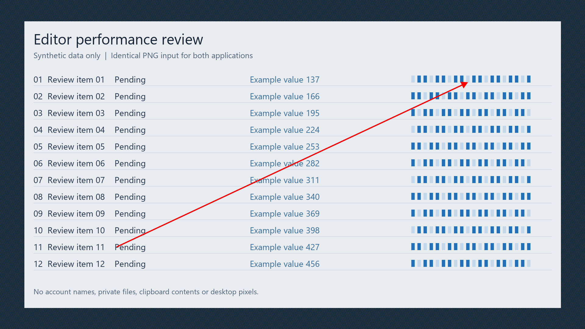
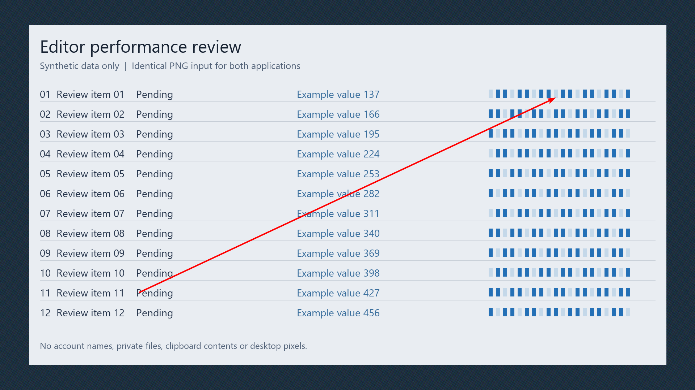
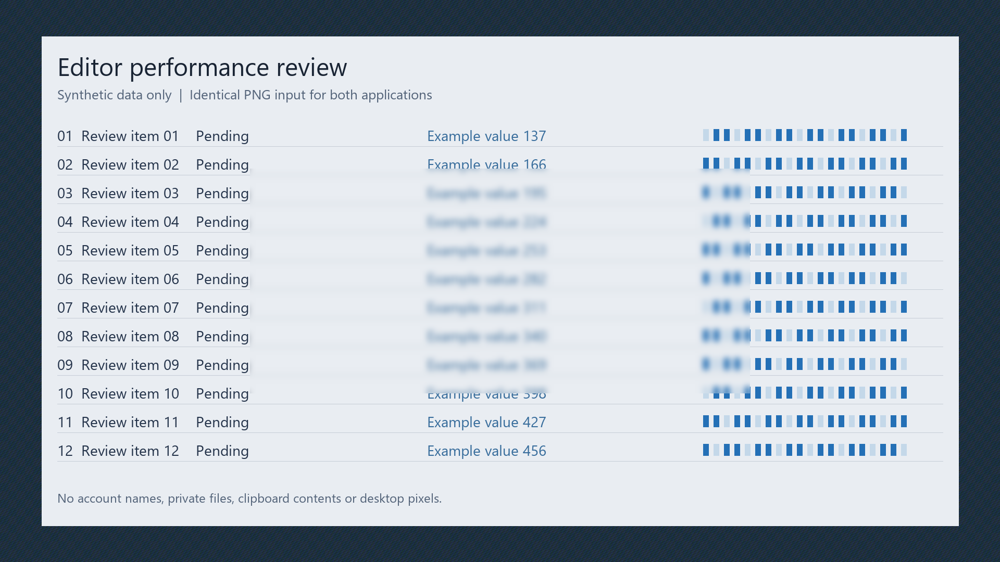
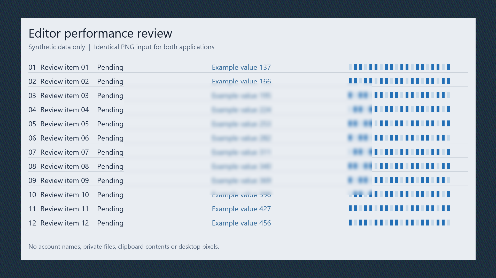

# Editor comparison protocol and export baseline

This work separates interaction from image export. A fast screenshot API does not establish that the editor responds faster. The previous documentation WIC adapter and its programmed animation are not used as interaction benchmarks.

## Shared input

`tools/runtime-compare/editor_fixture.py` generates a review sheet at 1920×1080 and 3840×2160. Both applications receive exactly the same PNG at each resolution. The fixture contains no desktop pixels, account data, private documents or clipboard contents. The JSON manifest records PNG hashes and the input trajectory.

| Fixture | Bytes | SHA-256 |
|---|---:|---|
| 1920×1080 | 173139 | `7486d90d7c4a8dc5bb596fa17050b56aee5a9d6541d83c3ab9db2eecc1db66d3` |
| 3840×2160 | 440955 | `9a2f5fcc50b408f8f4f646ff02d138d091278ae6a3c2d5c6c082101aac37e896` |

The arrow runs from `(0.2w, 0.75h)` to `(0.8w, 0.25h)`. Its stroke is opaque red, four image pixels wide, with shadow disabled. Freehand uses 120 points over two seconds, following `x/w = 0.15 + 0.7i/119` and `y/h = 0.5 + 0.18 sin(6πi/119)`. The manifest includes every timestamp and point. The blur region starts at `(0.25w, 0.3h)` and covers `(0.5w, 0.4h)`, with each application's radius setting at 15.

## Production export microbenchmark

The native harness directly includes the unchanged production `src/editor.cpp` and calls `Editor::Export`. This method already uses a WIC bitmap render target in the actual application. No target replacement from the README helper is involved.

The managed harness calls the installed, unmodified ShareX 18.0.1 `ShapeManager.RenderOutputImage` method. The internal manager is allocated as a data-only object without its form/event constructor, then receives its shapes and DPI. The arrow, freehand and blur classes are the actual installed classes. It does not create a ShareX form or run ShareX's main application. This measures that export component and excludes UI construction, event dispatch and presentation.

Input loading, output disposal, verification and PNG encoding happen outside the timed interval. The timer covers full-image output allocation and production rendering/readback. Each process performs three warmups and ten measured calls. Three alternating blocks produce 30 measurements for each app, case and resolution, or 720 measured exports overall. Both harnesses use normal priority and the same first four logical CPUs. Other user applications remain running.

The scenarios are an unchanged image, one arrow, 32 arrows, a 120-point freehand stroke, an uncached blur and a repeated blur. Every output has its dimensions checked. Annotated cases must change pixels, and the unchanged-image case must preserve them. Each block saves a real output PNG. The validation pass checked all 72 PNG hashes against the raw records and found stable output signatures across the three blocks of every case.

The legacy installed-version data is retained in [editor_export_18.0.1.json](editor_export_18.0.1.json). It includes all raw timings, source and binary hashes, fixture identity and verification. ShareX 18.0.1 ran on its original self-contained .NET 9.0.8 runtime. These results do not represent the current ShareX 22.4.0 release. The current-version interaction recordings are documented separately in [editor_UI_RESULTS.md](editor_UI_RESULTS.md).

## Export results for the installed ShareX 18.0.1

All numbers below are milliseconds. Each cell lists median, nearest-rank p95 and maximum across 30 calls. These are export timings and cannot be interpreted as input lag or frame pacing.

| Image | Operation | Zipshot median / p95 / max | ShareX 18.0.1 median / p95 / max |
|---|---|---:|---:|
| 1920×1080 | Unchanged image | 3.201 / 3.500 / 3.616 | 0.901 / 1.004 / 1.014 |
| 1920×1080 | One arrow | 3.400 / 4.085 / 4.167 | 0.946 / 1.177 / 1.205 |
| 1920×1080 | 32 arrows | 4.401 / 4.692 / 4.828 | 2.698 / 3.115 / 3.197 |
| 1920×1080 | Freehand | 3.761 / 4.272 / 4.494 | 1.272 / 1.537 / 1.560 |
| 1920×1080 | Blur, uncached | 57.531 / 59.993 / 63.466 | 10.628 / 10.861 / 10.899 |
| 1920×1080 | Blur, repeated | 4.019 / 5.031 / 5.045 | 10.563 / 10.723 / 10.823 |
| 3840×2160 | Unchanged image | 14.213 / 15.174 / 15.188 | 3.827 / 4.291 / 4.388 |
| 3840×2160 | One arrow | 14.039 / 14.534 / 14.559 | 4.026 / 4.329 / 4.373 |
| 3840×2160 | 32 arrows | 15.947 / 16.528 / 16.865 | 8.699 / 8.890 / 9.106 |
| 3840×2160 | Freehand | 14.845 / 15.405 / 15.411 | 4.902 / 5.303 / 5.454 |
| 3840×2160 | Blur, uncached | 262.917 / 269.544 / 270.634 | 42.748 / 44.633 / 47.017 |
| 3840×2160 | Blur, repeated | 18.005 / 21.644 / 21.735 | 43.113 / 55.892 / 58.937 |

ShareX exports the vector cases faster in this test. Zipshot benefits when its blur cache is reused, while the initial blur is substantially more expensive. Neither observation establishes interactive frame pacing.

### Blur settings do not specify identical work

Zipshot's native annotation path computes three horizontal/vertical box passes with half-width `floor(15/3) = 5` over the whole source image, then caches it and clips the displayed result to the region. ShareX 18.0.1 exports a crop of the selected region and runs two horizontal/vertical passes with an odd range of 15, or half-width 7. Its UI cache is separately computed on a background task, while its export method recomputes the crop.

The kernels, edge handling, processed area and cache behavior differ. Radius 15 is therefore a matching setting value, not a claim of matching blur quality. No apples-to-apples blur speed ratio is presented. The actual examples below make the output differences visible.

| Zipshot export | ShareX 18.0.1 export |
|---|---|
| [](editor_zipshot_arrow_1920.png) | [](editor_sharex18_arrow_1920.png) |
| [](editor_zipshot_blur_1920.png) | [](editor_sharex18_blur_1920.png) |

The vector paths also use different rasterizers and arrow-cap implementations. Their requested points, color, width and shadow setting match, but exact output pixel equality is not expected.

## Real interaction measurement

Interactive work runs only in an approved Windows Sandbox guest. `editor_ui_native.cpp` refuses before creating any window unless the account is `WDAGUtilityAccount`, the process is in a nonzero interactive session, `ZIPSHOT_RUNTIME_ISOLATED=1` is set and `C:\ZipshotLab\input\.isolation-approved.json` exists. A host refusal check must return exit code 20.

The helper compiles the unchanged production editor with its original `ID2D1HwndRenderTarget`. It opens an actual editor window and reports its document-to-client transform for the shared image-coordinate trajectory. The guest controller sends real input to that window. The helper records receipt of mouse/key messages and CPU duration of `WM_PAINT`. It does not call `DwmFlush` or force paints during the measured sequence.

Handler receipt and paint CPU duration are not visible-frame latency. The guest capture must independently observe the rendered pixels and retain timestamped frames or compositor-present evidence. A measurement should report the first visible annotation after input, delivered points, frame intervals, p95/max gaps, and intervals longer than one and two display refresh periods. Zoom and undo require the same actual visual verification, including restoration of the expected image state.

### Current ShareX 22.4.0 has a different editor

The official 22.4.0 portable release uses `ShareX.ImageEditor.dll` with an Avalonia and SkiaSharp hybrid renderer. The legacy `ShapeManager` classes are no longer its editor implementation. The actual inspected editor assembly is version 22.4.0.0 with SHA-256 `f8c7c8b1a16e15e1bb15d79f3e389e79ad4724ae8f0b13c07c28c73870a0302a`, running under the shipped .NET 10.0.14 runtime.

Its `EditorCore.GetSnapshot` copies the source image without annotations. This was confirmed from the shipped method's IL call sequence and must not be used as a replacement for a complete annotated export. The correct `EditorView.GetSnapshot` renders the annotation visual tree. Any new export matrix must use and verify that method's actual annotated output.

The experimental `editor_ui_sharex22.cs` library host passed its host refusal check but failed guest annotation-canvas readiness. It is excluded from the published interaction evidence. A running process or an empty library window was not accepted as a rendered editor.

The successful current-version recordings launch the unmodified stock ShareX 22.4.0 application with `-portable -multi -silent -ImageEditor`. The task-owned portable profile configures the real `DefaultTaskSettings.ToolsSettings.ImageEditorOptions` object. The controller finds its actual Avalonia window, verifies process ownership and foreground state, derives the image transform from a captured displayed fixture, then sends physical guest mouse/key events. Actual captured annotations and saved edited PNGs are independently checked. It does not use `EditorCore.GetSnapshot` or a substitute renderer.

The standalone arrow/freehand cases use the same display, PNG, four-pixel red/no-shadow style and 120-point/two-second image-coordinate trajectory. Their fitted image scales are approximately 0.63958 and 0.63523, a 0.68% difference caused by the native window layouts. Real viewport mappings and every sent point are retained. Cursor and capture overhead are reported. Real-time video remains at its original speed. Any shared slow motion is an explicitly labeled supplementary view.

Four additional recordings launch the complete, unmodified applications and enter region capture through real guest `Ctrl+PrintScreen`. After an actual owned full-screen overlay appears, `A` or `F` selects the tool and the same two-second screen-coordinate trajectory draws directly on that overlay. These use each application's default annotation style and are separate from standalone-editor timing. [editor_region_runs.json](editor_region_runs.json) records their source hashes, offsets, actual output proof and limitations.

## Reproduce export measurements

```powershell
python tools/runtime-compare/editor_fixture.py
.\tools\runtime-compare\editor_build.bat
.\tools\runtime-compare\editor_build_managed.ps1
.\tools\runtime-compare\editor_run.ps1
```

Use separate runtime-stage paths for different ShareX versions. Only a task-owned stage may receive the compiled harness as `ShareX.dll`. Linked original runtime/library files must never be modified. To revalidate an existing run without rerunning the apps, call `editor_summarize.py` on its `editor-export-results.json`.

The current optimization candidate is the synchronous whole-image blur cache fill. Region-limited work or background preparation may reduce its initial cost, but any change requires separate approval, preserved baseline data and output checks. No production performance code was changed for this baseline.

## Primary implementation references

- [ShareX 18.0.1 ShapeManager](https://github.com/ShareX/ShareX/blob/v18.0.1/ShareX.ScreenCaptureLib/Shapes/ShapeManager.cs)
- [ShareX 18.0.1 BaseEffectShape](https://github.com/ShareX/ShareX/blob/v18.0.1/ShareX.ScreenCaptureLib/Shapes/Effect/BaseEffectShape.cs)
- [ShareX 18.0.1 BoxBlur](https://github.com/ShareX/ShareX/blob/v18.0.1/ShareX.HelpersLib/Helpers/ImageHelpers.cs)
- [Zipshot production editor](../../src/editor.cpp)
- [Official ShareX 22.4.0 release](https://github.com/ShareX/ShareX/releases/tag/v22.4.0)
- [Official ShareX.ImageEditor project](https://github.com/ShareX/ShareX.ImageEditor)
