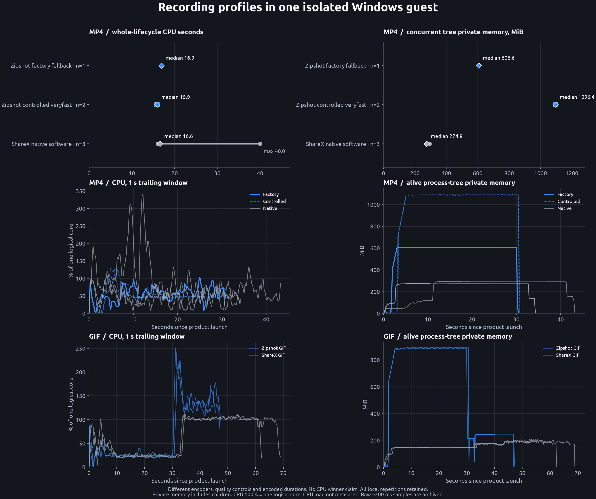

# Actual MP4 and GIF recording

[Play the 10-second comparison](../../media/runtime/recording-profile.mp4) or open its [GIF preview](../../media/runtime/recording-profile.gif). Both sides show actual saved MP4 files from the same original fixture in a clean Windows Sandbox. The excerpts start at the identical recorded fixture tick 220 and play at 1×. Only timestamp origins are reset. This is saved output, not a capture-start latency race.

The left source is Zipshot 1.0.1 with its factory software fallback preset. Its fresh INI contains no X264Preset override, and the actual command and embedded x264 settings confirm ultrafast, CRF 23. That trial successfully used DDA capture after an initial failure. The right source is the predeclared first local ShareX 22.4.0 repetition, using its native recorder with software encoding allowed and 10,000 kbps configured. The encoders, quality controls, capture backends and observed fixture cadence differ. These are not equal-quality codec profiles.

Both request 1920×1080 at 30 fps with cursor and audio off. The complete source files contain 851 decoded frames over 28.4 seconds for Zipshot and 900 over 30 seconds for ShareX. Observed encoded averages are approximately 29.96 and 30.00 fps. The 30 Hz fixture has approximately 27.6 and 14.1 distinct captured states per second in these specific files. The guest remote display limits interpretation; neither the encoded frame count nor this fixture establishes a normal-desktop 60 fps guarantee. The GIF linked above is a 12 fps presentation preview of the paired MP4, not either application's original GIF export.

## CPU and RAM evidence

The figure shows every local repetition, including the native MP4 outlier. Dots are individual repetitions, lines show the observed range and diamond labels show medians. CPU curves use a one-second trailing window derived from actual cumulative CPU samples. Memory curves sum only alive processes in the same sample. Raw nominal 200 ms snapshots, actual timestamps, parent/child values and exact CSV curves are retained.

| Profile | Repetitions | Encoded duration | Whole-lifecycle CPU | Peak concurrent private memory |
|---|---:|---:|---:|---:|
| Zipshot factory fallback MP4 | 1 exploratory | 28.4 s | 16.92 CPU-s | 606.6 MiB |
| Zipshot controlled veryfast MP4 | 2 | 27.37 s | 15.72–16.09 CPU-s | 1096.4 MiB |
| ShareX native, software allowed MP4 | 3 | 30 s | 16.03–40.00 CPU-s | 273.7–293.0 MiB |
| Zipshot default full-palette GIF, cursor off | 2 | 28.40–28.94 s | 30.81–32.47 CPU-s | 890.8–890.9 MiB |
| ShareX native adaptive GIF | 2 | 30 s | 38.34–45.91 CPU-s | 203.0–209.4 MiB |

These different durations and codec settings do not support a general CPU winner claim. They also do not support claiming that Zipshot recording always uses less RAM. Most Zipshot recording memory in these software profiles belongs to FFmpeg children. Its factory MP4 preset is distinct from the controlled veryfast profile. The successful capture backend also differed between those profiles, so their memory difference must not be attributed solely to the preset.

The native MP4 producer reported zero dropped frames in two runs and 16 in the outlier. All three are retained. Its native GIF producer reported 450 frames with zero drops; the adaptive encoder coalesced repeated images into fewer GIF frames. A smaller decoded GIF frame count alone is not a dropped-frame count. Encoder hardware acceleration flags do not measure total GPU use. GPU counters were attempted, but no samples could be attributed to the owned recording process IDs, so GPU load is not measured.

## Environment controls and verified limitations

The guest could not load FFmpeg CUDA, and the native ShareX requirement for D3D11 hardware encoding failed. Software-allowed MP4 is explicitly labeled. DDA was intermittent; the actual successful backend is recorded per case. Timed Zipshot tests consumed some requested time in startup and fallback attempts. A three-second test returned zero without a media file, so every accepted result was checked by actual file existence, ffprobe frame counts, full decoding and the moving fixture tick.

A separate identical-image control found repeated approximately 2.7-second process creation through the mapped input path. After initialization, the byte-identical guest-local executable launched in approximately 1.3 ms. Canonical results therefore use local executable images and local hot output, with shared FFmpeg initialized outside the measured lifecycle. Earlier mapped-input observations remain diagnostic data. No application source or encoder thread budget was changed for these comparisons. A separate synthetic thread-budget control is an engineering proposal, not an application recording result or a GIF memory claim.

[Per-trial numbers, medians and ranges](recording_local_summary.json), [CSV table](recording_local_summary.csv), [raw CPU/RAM curve CSV files](recording_curves/), [media provenance and source hashes](../../media/runtime/recording-profile.json), and [the complete protocol](recording_protocol.md) accompany the result. Original recording jobs were hash-copied to the task archive; the recording archive manifest contains 368 verified files totaling 127,675,625 bytes, and the source D-drive copies remain intact. Public evidence packages should include selected generated media, logs, JSON/CSV and source documents only, excluding app/runtime/vendor directories, executables, DLLs, PDBs, VM images and host/RDP session files.
